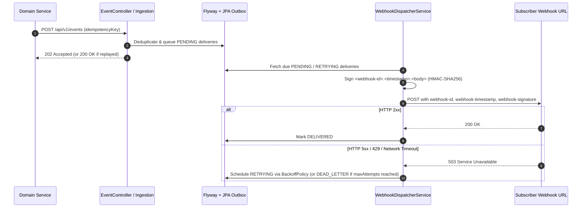

# Webhook Relay Engine

[](https://github.com/MickaelGeronimo/webhook-relay-engine/actions/workflows/ci.yml)


A production-oriented outbound webhook delivery engine aligned with the **Standard Webhooks** specification, built with **Java 17**, **Spring Boot 3**, **Spring Data JPA**, **Flyway**, and **RestClient**. Handles idempotent event ingestion, HMAC-SHA256 signing with zero-downtime secret rotation, SSRF URL protection, exponential backoff retries with jitter, and Dead-Letter Queue (DLQ) replay.

---

## Delivery Lifecycle



---

## Key Security & Reliability Features

- **Standard Webhooks HMAC-SHA256 Signing (`StandardWebhookSigner`)**:
  - Generates `whsec_`-prefixed 256-bit random secrets and signs `<webhook-id>.<unix-timestamp>.<body>`.
  - Verifies signatures with `MessageDigest.isEqual` (constant-time comparison) and enforces a configurable timestamp replay window (default 300 seconds).
  - Supports **zero-downtime secret rotation** (`POST /api/v1/endpoints/{id}/rotate-secret`): outbound requests carry both the new and previous `v1,<base64>` signatures until receivers migrate.
- **SSRF Protection (`WebhookUrlValidator`)**:
  - Rejects non-HTTP(S) schemes, embedded URL credentials, `localhost`, `.local`, loopback (`127.0.0.1`, `::1`), site-local (`10.x`, `172.16-31.x`, `192.168.x`), CGNAT (`100.64.0.0/10`), and cloud metadata link-local addresses (`169.254.169.254`).
- **Idempotent Ingestion & Outbox Fan-Out**:
  - Unique constraint on `(tenant_id, idempotency_key)` guarantees duplicate publishes return `200 OK` (`deduplicated: true`) without fanning out duplicate deliveries.
- **Retry State Machine & DLQ Replay**:
  - Permanent 4xx errors (except `408`/`429`) move immediately to `DEAD_LETTER`; transient `5xx`/`429`/network errors retry with `BackoffPolicy` (exponential backoff + bounded jitter).
  - Operators can inspect every attempt via `GET /api/v1/deliveries/{id}/attempts` and replay `DEAD_LETTER` items via `POST /api/v1/deliveries/{id}/replay`.

---

## Quick Start

### Run Locally (Embedded H2 in PostgreSQL Mode)

```bash
mvn spring-boot:run
```

Swagger UI is available at `http://localhost:8081/swagger-ui.html`.

### Run with Docker Compose & PostgreSQL 16

```bash
docker compose up --build
```

### Run Full Verification Suite

```bash
mvn -B clean verify
```

---

## API Usage Examples

### 1. Register a Subscriber Endpoint

```bash
curl -X POST http://localhost:8081/api/v1/endpoints \
  -H "Content-Type: application/json" \
  -d '{
    "tenantId": "pay-core",
    "targetUrl": "https://hooks.partner.test/webhooks/payments",
    "eventTypes": ["payment.settled", "payment.failed"],
    "maxRetries": 5
  }'
```

### 2. Publish an Idempotent Event

```bash
curl -X POST http://localhost:8081/api/v1/events \
  -H "Content-Type: application/json" \
  -d '{
    "tenantId": "pay-core",
    "eventType": "payment.settled",
    "idempotencyKey": "pix-tx-2026-001",
    "payload": "{\"transactionId\":\"tx_001\",\"amountCents\":15000}"
  }'
```

### 3. Dispatch Due Deliveries & Replay Dead Letters

```bash
curl -X POST http://localhost:8081/api/v1/deliveries/dispatch
curl -X POST http://localhost:8081/api/v1/deliveries/{deliveryId}/replay
```

### 4. Verify a Standard Webhooks Signature

```bash
curl -X POST http://localhost:8081/api/v1/signatures/verify \
  -H "Content-Type: application/json" \
  -d '{
    "secret": "whsec_...",
    "webhookId": "msg_...",
    "timestampHeader": "1700000000",
    "signatureHeader": "v1,...",
    "payload": "{\"transactionId\":\"tx_001\"}"
  }'
```
